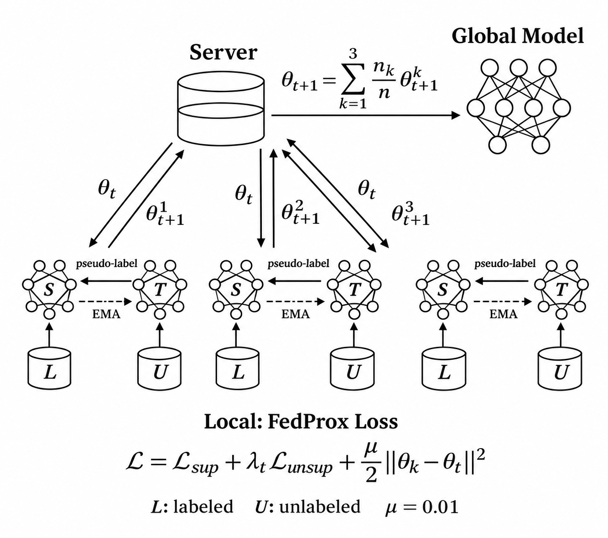

# SemiFedFlood

**Semi-supervised Federated Learning for Flood-Area Segmentation**

This repository contains the full implementation code and dataset for the research paper on semi-supervised federated learning applied to satellite flood segmentation. The system compares centralized and federated training strategies under limited label availability using a student-teacher pseudo-labeling scheme.

---

## Repository Structure

```
SemiFedFlood/
├── notebooks/
│   └── SemiFloodFed.ipynb      # Main experiment notebook (full pipeline)
├── assets/
│   └── architecture.png        # System architecture diagram
├── data/
│   └── flood_area/
│       ├── Image/              # Satellite flood images (.jpg)
│       ├── Mask/               # Binary segmentation masks (.png)
│       └── metadata.csv        # Dataset metadata and splits
├── requirements.txt
└── README.md
```

---

## Experiment Overview

The main notebook (`notebooks/SemiFloodFed.ipynb`) implements and compares six training configurations:

| Configuration | Supervision | Federation |
|---|---|---|
| Centralized ResNet-50 | Fully supervised | None |
| FedAvg | Fully supervised | ✓ |
| FedAvg + 20% labels | Semi-supervised | ✓ |
| FedAvg + Student-Teacher | Semi-supervised (pseudo-labels) | ✓ |
| FedProx + 20% labels | Semi-supervised | ✓ |
| FedProx + Student-Teacher | Semi-supervised (pseudo-labels) | ✓ |

All configurations share the same train/validation/test split, client allocation, label budget, and evaluation protocol to ensure a controlled, fair comparison.

---

## Architecture



The system uses a **U-Net** backbone for flood mask segmentation. In federated settings, clients train locally on their assigned labeled (and optionally pseudo-labeled) samples, then aggregate weights via FedAvg or FedProx on a central server.

---

## Running the Notebook

### Google Colab (Recommended)

1. Open `notebooks/SemiFloodFed.ipynb` in Google Colab.
2. Select a **GPU runtime** (Runtime → Change runtime type → T4 GPU).
3. Upload `flood_area.zip` to your Drive at:
   ```
   /content/drive/MyDrive/DLP_Project/flood_area.zip
   ```
4. Run all cells.

Outputs (checkpoints, metrics, plots, predictions, error maps) are saved under a timestamped directory in Google Drive.

### Local / Alternate Environment

Update the following variables near the top of the notebook to match your environment:

```python
ZIP_PATH       = "/path/to/flood_area.zip"
DATA_ROOT_LOCAL = "/path/to/extracted/flood_area"
CACHE_ROOT     = "/path/to/cache"
PROJECT        = "/path/to/output"
```

---

## Dataset

The dataset (`data/flood_area/`) contains satellite imagery paired with binary flood segmentation masks.

- `Image/` — RGB satellite images (`.jpg`)
- `Mask/` — Binary masks (`.png`), white = flood, black = non-flood
- `metadata.csv` — Maps image IDs to file paths and split assignments

---

## Requirements

```bash
pip install -r requirements.txt
```

**Recommended environment:**
- Python 3.9+
- PyTorch ≥ 2.0 with CUDA
- Google Colab (for the provided end-to-end workflow)

---

## Reproducibility

The notebook uses fixed random seeds throughout. Architecture-specific normalization is preserved:

- **ResNet-50**: ImageNet-standardized RGB inputs (mean/std normalization)
- **U-Net**: `[0, 1]` normalized RGB inputs

The dataset split, client allocation, labeled subset selection, and evaluation metrics are logged per run.

---

## Citation

If you use this code or dataset in your work, please cite the associated research paper and this repository.
